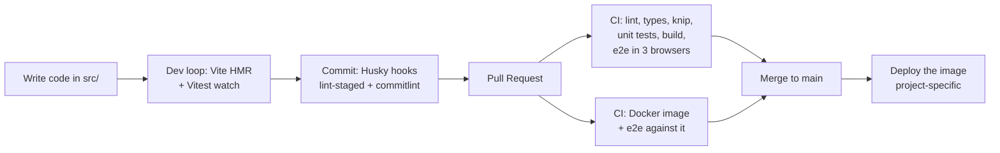

# Project Guide — Learn this React + TypeScript SPA setup from scratch

> A guided tour of **every tool, file, and decision** in this repository, written for a
> junior developer. For each piece you'll learn **what it is**, **what problem it
> solves**, **why we chose it** (and why not the alternatives), and you'll get a small
> **"Try it"** exercise so you learn by doing.

This is not API documentation. It's a learning document about _how a modern frontend
application is configured and why_. For the list of decisions with their status (final or
provisional) and the sources behind them, see [DECISIONS.md](./DECISIONS.md).

---

## How to read this guide

Every section follows the same template:

- **What it is** — a plain-language definition.
- **Why we did it this way** — the reasoning behind the decision.
- **Alternatives (and why not)** — what else exists and the trade-offs.
- **Try it 🧪** — a hands-on exercise to cement the idea.
- **Learn more 📚** — official docs to go deeper.

Suggested learning path (each builds on the previous one):

1. [The big picture](#1-the-big-picture) — how everything connects.
2. [TypeScript & the compiler configs](#2-typescript--the-compiler-configs) ⭐ _must-know_
3. [Vite: dev server, build & environment](#3-vite-dev-server-build--environment) ⭐ _must-know_
4. [The application layer](#4-the-application-layer) ⭐
5. [The package manager & supply chain (pnpm)](#5-the-package-manager--supply-chain-pnpm)
6. [Code quality: ESLint, Prettier, markdownlint & knip](#6-code-quality-eslint-prettier-markdownlint--knip) ⭐
7. [Unit & component tests (Vitest, Testing Library, MSW)](#7-unit--component-tests-vitest-testing-library-msw) ⭐
8. [End-to-end & accessibility tests (Playwright, axe)](#8-end-to-end--accessibility-tests-playwright-axe)
9. [Git hygiene: hooks & commit conventions](#9-git-hygiene-hooks--commit-conventions)
10. [Continuous Integration (CI)](#10-continuous-integration-ci)
11. [Deployment: the Docker image](#11-deployment-the-docker-image)
12. [Dependency maintenance (Dependabot)](#12-dependency-maintenance-dependabot)
13. [Developer experience & environment](#13-developer-experience--environment)
14. [Repository meta files](#14-repository-meta-files)
15. [Glossary](#15-glossary)
16. [FAQ & common errors](#16-faq--common-errors)

> ⭐ = the concepts you should understand first; the rest you can absorb as you need them.

---

## 1. The big picture

This project is a **single-page application (SPA)**: the server sends one HTML page and a
bundle of JavaScript, and from then on **React renders every screen in the browser**.
Changing pages doesn't reload anything — the router swaps components and updates the URL.
Data comes from a **separate backend** over HTTP (`/api/...`); this repository contains only
the frontend.

That shape drives the main decisions:

- What we ship is **static files** (`dist/`). Any web server can host them, but it must send
  `index.html` for every app URL so that `/status` works on a reload (the "SPA fallback").
- Everything we ship is **public**. Code and configuration run on the user's machine, so no
  secret can ever be part of the build.
- The backend is **outside our type system**. Its responses are validated at runtime before
  the app trusts them.

Here's how a change travels from your editor to production:



**Try it 🧪** — Before reading further, skim these files; you'll understand them by the end:
[`package.json`](../package.json), [`vite.config.ts`](../vite.config.ts),
[`src/main.tsx`](../src/main.tsx), [`src/app/routes.ts`](../src/app/routes.ts),
[`Dockerfile`](../Dockerfile).

---

## 2. TypeScript & the compiler configs

### What it is

[TypeScript](https://www.typescriptlang.org/) is JavaScript with **static types**. Here
`tsc` is used **only to check types** (`noEmit`); Vite turns the code into JavaScript.

This repo contains code for **two different environments**: the app runs in a **browser**
(it has `window` and `document`, but no `process` or `fs`), while the config files and the
Playwright tests run on **Node**. Each gets its own config, so neither can accidentally use
the other's APIs:

| File                                          | Covers                               | Environment                        |
| --------------------------------------------- | ------------------------------------ | ---------------------------------- |
| [`tsconfig.json`](../tsconfig.json)           | nothing itself — lists the other two | solution root                      |
| [`tsconfig.base.json`](../tsconfig.base.json) | shared strictness flags              | —                                  |
| [`tsconfig.app.json`](../tsconfig.app.json)   | `src/` (app + unit tests)            | browser: `lib: dom`, `vite/client` |
| [`tsconfig.node.json`](../tsconfig.node.json) | `*.ts` configs, `e2e/`               | Node: `types: node`, `nodenext`    |

### Why we did it this way

- **Solution-style root with project references** is the layout Vite's own React template
  uses. `pnpm typecheck` runs `tsc --build`, which checks both programs; editors and
  type-aware ESLint follow the same references.
- **A shared base** keeps the strictness in one place, so the two programs can't drift apart.
- **Bundler resolution** (`moduleResolution: bundler`) in the app: imports are written
  without extensions (`./health-api`), exactly as Vite resolves them.
- **`types: ["vite/client"]`** teaches TypeScript about Vite features: `import.meta.env`,
  CSS modules (`import styles from './x.module.css'`), and asset imports.

The strictness flags (in the base config):

| Flag                                    | What it does                                                                 | Why                                                          |
| --------------------------------------- | ---------------------------------------------------------------------------- | ------------------------------------------------------------ |
| `strict`                                | Enables all the core strict checks (e.g. `strictNullChecks`).                | The single most valuable setting in TS. Non-negotiable.      |
| `noUncheckedIndexedAccess`              | `arr[i]` is typed as `T \| undefined`.                                       | Forces you to handle the "what if it's missing?" case.       |
| `exactOptionalPropertyTypes`            | `{ x?: number }` is not the same as `{ x: number \| undefined }`.            | Models optional-vs-undefined precisely; avoids subtle bugs.  |
| `verbatimModuleSyntax`                  | Type-only imports must say `import type`.                                    | Predictable output; types never become runtime imports.      |
| `isolatedModules`                       | Each file must be compilable alone.                                          | Required by single-file transpilers like the one Vite uses.  |
| `erasableSyntaxOnly`                    | Bans TS-only runtime constructs (`enum`, `namespace`, parameter properties). | The code stays plain JavaScript once the types are stripped. |
| `noUnusedLocals` / `noUnusedParameters` | Errors on dead variables.                                                    | Keeps code clean; catches mistakes.                          |
| `noUncheckedSideEffectImports`          | Errors on a side-effect import (`import './x.css'`) that doesn't resolve.    | Catches typos in CSS and polyfill imports.                   |
| `target: es2023`                        | The language level types are checked against.                                | A fixed year keeps the check reproducible (unlike `esnext`). |

### Alternatives (and why not)

- **One `tsconfig.json` for everything** — simpler, but browser and Node types leak into
  each other: `process.env` would type-check inside a component and then crash in the
  browser.
- **TypeScript 7 (the native Go compiler)** — much faster, but the type-aware linter
  (`typescript-eslint`) doesn't support it yet, so the seed stays on TypeScript 6.0. See
  [DECISIONS.md](./DECISIONS.md).

### Try it 🧪

1. In [`src/routes/home-page.tsx`](../src/routes/home-page.tsx), use `process.env.HOME` and
   run `pnpm typecheck`: the browser program doesn't know `process`. Revert.
2. Add `const unused = 1;` anywhere and watch `noUnusedLocals` reject it.

### Learn more 📚

- [TSConfig reference](https://www.typescriptlang.org/tsconfig)
- [Project references](https://www.typescriptlang.org/docs/handbook/project-references.html)

---

## 3. Vite: dev server, build & environment

### What it is

[Vite](https://vite.dev/) is the build tool. It does two jobs:

- **`pnpm dev`** — a dev server that serves your source almost untouched and applies changes
  instantly with **HMR** (hot module replacement: the edited component updates in place and
  keeps its state).
- **`pnpm build`** — a production bundle in `dist/`: minified, split into chunks, and with
  **content hashes** in file names (`index-DFw1Um_g.js`) so they can be cached forever.

Its config, [`vite.config.ts`](../vite.config.ts), also holds the Vitest config (Section 7),
so both tools share the same plugins and resolution.

### Why we did it this way

- **Vite is the community default** for React SPAs; React's own docs point to it for
  building an app without a framework.
- **`@vitejs/plugin-react`** adds the JSX transform and React Fast Refresh (the HMR part).
- **A dev proxy for `/api`** — the app calls `/api/...` on its own origin; in development
  Vite forwards those calls to the backend (`API_PROXY_TARGET`, default
  `http://localhost:3000`). The browser sees one origin, so no CORS setup is needed.
- **Route-level code splitting** — the `/status` page is loaded with `lazy` in
  [`src/app/routes.ts`](../src/app/routes.ts), so its code becomes a separate chunk that is
  only downloaded when visited. Look for `status-page-*.js` in the build output.

### Environment variables: the most important rule

Vite reads `.env` files and exposes to the app **only** the variables prefixed with
`VITE_`. Those values are **inlined into the JavaScript at build time** — they are not read
when the app runs, and anyone can see them in the browser's dev tools. Therefore:

- **Never put a secret in a `VITE_` variable.** API keys that must stay private belong in
  the backend.
- **Changing a value means rebuilding.** That's why the Dockerfile takes
  `VITE_API_BASE_URL` as a _build argument_ (Section 11).
- Variables **without** the prefix (like `API_PROXY_TARGET`) are only visible to
  `vite.config.ts` — tooling configuration that never reaches the bundle.

The app reads its environment in exactly one place,
[`src/config/env.ts`](../src/config/env.ts), which validates it with Zod when the module is
first loaded. A misconfigured build fails there with a clear validation error, instead of
sending requests to a malformed URL. Local overrides go in `.env.local` (git-ignored); the available
variables are documented in [`.env.example`](../.env.example).

### Alternatives (and why not)

- **A meta-framework (Next.js, React Router framework mode, TanStack Start)** — adds
  server-side rendering, which helps SEO and first paint. It also means running a Node server
  in production. For an app behind a login that talks to its own backend, an SPA served as
  static files is simpler to operate.
- **webpack / Create React App** — CRA is deprecated; webpack is still capable but slower
  and far more configuration than Vite.

### Try it 🧪

1. Run `pnpm build` and look at the chunks it prints: the status page is its own file.
2. Run `VITE_API_BASE_URL= pnpm build` (an empty value), then `pnpm preview` and open
   `/status`: the page that uses the API renders the error page, and the console shows the
   Zod error — the environment check doing its job. Run `pnpm build` again to restore it.

### Learn more 📚

- [Vite guide](https://vite.dev/guide/)
- [Env variables and modes](https://vite.dev/guide/env-and-mode)

---

## 4. The application layer

### What it is

The code in `src/`, split by responsibility:

| Path                                                | Responsibility                                                    |
| --------------------------------------------------- | ----------------------------------------------------------------- |
| [`main.tsx`](../src/main.tsx)                       | Entry point: creates the router and query client, mounts the app. |
| [`app/routes.ts`](../src/app/routes.ts)             | The route table: which component renders for each URL.            |
| [`app/root-layout.tsx`](../src/app/root-layout.tsx) | The shell around every page: header, navigation, `<main>`.        |
| [`routes/`](../src/routes/)                         | One thin component per page.                                      |
| [`features/health/`](../src/features/health/)       | A feature module: its API query and the components that show it.  |
| [`lib/api-client.ts`](../src/lib/api-client.ts)     | The typed `fetch` wrapper every feature uses.                     |
| [`config/env.ts`](../src/config/env.ts)             | The validated environment.                                        |

Three libraries do the heavy lifting:

- **[React Router](https://reactrouter.com/)** — maps URLs to components (`createBrowserRouter`).
- **[TanStack Query](https://tanstack.com/query)** — fetches, caches and refreshes **server
  state** (data that lives on the backend).
- **[Zod](https://zod.dev/)** — validates data at runtime and infers its TypeScript type.

### Why we did it this way

- **Features, not file types.** Grouping by feature (`features/health/` holds the query _and_
  the component) keeps related code together and lets a feature be moved or deleted as one
  folder. Pages in `routes/` stay thin: they compose features.
- **Server state ≠ UI state.** Most "state" in a frontend is really a cached copy of backend
  data. TanStack Query handles caching, de-duplication, retries, refetching on focus and
  request cancellation, which hand-written `useEffect` + `useState` fetching gets wrong in
  subtle ways (race conditions, missing loading/error states). Local UI state stays in React
  (`useState`); add a global store only when a real need appears.
- **Query options defined once.** [`health-api.ts`](../src/features/health/health-api.ts)
  exports `healthQueryOptions` (key + fetcher together), so every consumer shares the same
  cache entry and the key can't be mistyped.
- **Validate API responses.** [`getJson`](../src/lib/api-client.ts) takes a Zod schema and
  parses the body. A backend change shows up as a clear validation error at the boundary,
  not as `undefined is not a function` three components later.
- **Errors are handled per level.** A failed request renders an error state in its component
  (`role="alert"`); a crash while rendering a route is caught by the router's
  `ErrorBoundary` ([`error-page.tsx`](../src/routes/error-page.tsx)), which shows details only
  in development; unknown URLs render [`not-found-page.tsx`](../src/routes/not-found-page.tsx).
- **Accessible by default.** Semantic landmarks (`header`, `nav`, `main`), one `h1` per page,
  a per-page `<title>` (React 19 hoists it into `<head>`), `aria-current` on the active link
  (set by `NavLink`), and a visible `:focus-visible` outline.
- **Styling with plain CSS + CSS Modules.** Global tokens live in
  [`styles.css`](../src/styles.css) as custom properties (with a dark-mode variant);
  component styles use CSS Modules (`root-layout.module.css`), which scope class names per
  file with no extra dependency.

### Alternatives (and why not)

- **TanStack Router** — excellent type-safe routing, but React Router remains the most widely
  used router; either is a sound choice.
- **Redux / Zustand for everything** — a global store for server data reimplements what
  TanStack Query does. Reach for Zustand (or similar) only for genuinely global _client_
  state.
- **Tailwind CSS** — very popular and productive; left out so the seed doesn't impose a
  styling methodology. It can be added in minutes.
- **Axios** — `fetch` is built into every browser and Node; a 40-line wrapper covers what the
  app needs.

### Try it 🧪

1. Start `pnpm dev` without a backend and open `/status`: the error state appears. Now open
   the browser's network tab and notice that TanStack Query retried the request before
   giving up.
2. Add a field to `healthSchema` in
   [`health-api.ts`](../src/features/health/health-api.ts) (for example
   `version: z.string()`) and run `pnpm test:run`: the happy-path test now fails, because
   the mocked response no longer matches the contract. Revert.

### Learn more 📚

- [React: Thinking in React](https://react.dev/learn/thinking-in-react)
- [React Router: routing](https://reactrouter.com/start/data/routing)
- [TanStack Query: overview](https://tanstack.com/query/latest/docs/framework/react/overview)

---

## 5. The package manager & supply chain (pnpm)

### What it is

[pnpm](https://pnpm.io/) installs the dependencies. The exact version is pinned in the
`packageManager` field of [`package.json`](../package.json), which Corepack (bundled with
Node) uses automatically. Its settings live in
[`pnpm-workspace.yaml`](../pnpm-workspace.yaml).

### Why we did it this way

- **Strict and efficient** — pnpm's layout prevents "phantom dependencies" (importing a
  package you never declared), and its global store makes installs fast.
- **`pnpm-lock.yaml` + `--frozen-lockfile`** — exact versions for everyone; CI fails instead
  of silently resolving something new.
- **`engineStrict: true`** — the `engines` field (Node `>=24`, pnpm `>=12`) becomes a hard
  requirement: an install on an unsupported version fails up front.
- **`minimumReleaseAge: 1440`** — pnpm never resolves a version published less than a day
  ago. Malicious releases (a hijacked maintainer account publishing malware) are usually
  detected and pulled within hours; waiting a day keeps you out of that window. pnpm also
  verifies the existing lockfile against this policy on every install. Dependabot waits
  even longer (Section 12), so its PRs never trip the check.
- **Why there's no `allowBuilds` list** — pnpm blocks dependency install scripts by default,
  and none of the current dependencies needs one (Vite 8's native parts arrive as
  prebuilt packages). If a future dependency needs a build script, pnpm fails the install
  and tells you to allow it explicitly.

### Alternatives (and why not)

- **npm** — ships with Node, but looser (allows phantom dependencies) and slower.
- **Bun** — very fast, but pnpm remains the more universally supported default.

### Try it 🧪

Run `pnpm why zod` to see who depends on it, then `pnpm install --frozen-lockfile` and
notice it does nothing — exactly what CI relies on.

### Learn more 📚

- [pnpm settings](https://pnpm.io/settings)
- [Corepack](https://nodejs.org/api/corepack.html)

---

## 6. Code quality: ESLint, Prettier, markdownlint & knip

### What it is

- **[ESLint](https://eslint.org/)** finds _problems_ in code. Configured in
  [`eslint.config.ts`](../eslint.config.ts).
- **[Prettier](https://prettier.io/)** enforces _formatting_. Configured in
  [`.prettierrc`](../.prettierrc).
- **[markdownlint](https://github.com/DavidAnson/markdownlint)** checks the structure of the
  docs.
- **[knip](https://knip.dev/)** reports unused files, exports and dependencies.

### Why we did it this way

The ESLint config stacks rule sets, each with a clear job:

| Rule set                                       | Applies to | Catches                                                                 |
| ---------------------------------------------- | ---------- | ----------------------------------------------------------------------- |
| `@eslint/js` recommended                       | everything | Core JavaScript mistakes.                                               |
| `typescript-eslint` strict + stylistic (typed) | everything | Floating promises, unsafe `any`, needless conditions — using type info. |
| `unicorn` recommended                          | everything | Modern idioms (`querySelector`, `kebab-case` file names, …).            |
| `sonarjs` recommended                          | everything | Code smells and likely bugs.                                            |
| `eslint-plugin-react-hooks` (official)         | `src/`     | Rules of Hooks, missing effect dependencies, React Compiler rules.      |
| `@eslint-react` recommended (typed)            | `src/`     | React bugs: missing `key`, leaked conditional rendering, leaked timers… |
| `eslint-plugin-react-refresh`                  | `src/`     | Exports that would break Fast Refresh during development.               |
| `eslint-config-prettier` (last)                | everything | Turns off every rule that would fight Prettier.                         |

A few deliberate adjustments, each commented in the config:

- **No duplicate React rules.** `@eslint-react` also ships its own copies of the hooks
  rules. The config switches those copies off, so each problem is reported once, by the React
  team's own plugin.
- **`env` is allowed as a name.** `unicorn/name-replacements` would rename it to
  `environment`, but `env` is the established name in this stack (`import.meta.env`,
  `loadEnv`, `process.env`).
- **Standard JSDoc layout.** `unicorn/no-asterisk-prefix-in-documentation-comments` is off,
  to keep the `*` layout that editors and the rest of the ecosystem use.
- **Tool configs may read `process.env` at the top level.** `*.config.ts` files are entry
  points their tool evaluates once, so `unicorn/no-top-level-side-effects` doesn't apply.
- **Tests relax two rules** (`no-unsafe-assignment`, `no-non-null-assertion`), because
  assertions poke at loosely typed values on purpose.

**Accessibility linting** — the long-standing `eslint-plugin-jsx-a11y` hasn't been released
since 2024 and doesn't support ESLint 10. Rather than depend on an unmaintained plugin
outside its supported range, accessibility is checked where it matters most: in a real
browser, by axe, in the e2e suite (Section 8).

**knip** needs no configuration: it reads the Vite, Vitest, Playwright and ESLint configs
(through its plugins), so it knows that `index.html` → `src/main.tsx` is the entry point and
that `e2e/*.spec.ts` are tests.

### Alternatives (and why not)

- **Oxlint / Biome** — much faster Rust-based linters (Vite's template now ships Oxlint).
  They don't yet match the depth of `typescript-eslint`'s type-aware rules and the React
  plugins above; a reasonable future swap once they do.

### Try it 🧪

1. In a component, call `fetch('/api/x')` inside a `useEffect` without an `AbortController`.
   Run `pnpm lint` and read what `@eslint-react/web-api-no-leaked-fetch` says. It is a
   warning, but `pnpm lint` runs with `--max-warnings=0`, so it still fails the build: a
   warning nobody has to fix only piles up.
2. Export an unused function from any file and run `pnpm knip`.

### Learn more 📚

- [typescript-eslint configs](https://typescript-eslint.io/users/configs)
- [Rules of Hooks](https://react.dev/reference/rules/rules-of-hooks)
- [ESLint React](https://eslint-react.xyz/)
- [Knip](https://knip.dev/)

---

## 7. Unit & component tests (Vitest, Testing Library, MSW)

### What it is

- **[Vitest](https://vitest.dev/)** runs the tests, reusing the Vite config. Tests run in
  **jsdom**, a simulated browser DOM inside Node.
- **[Testing Library](https://testing-library.com/)** renders components and finds elements
  the way users do: by role, label and text (`getByRole('heading', { name: 'API status' })`).
- **[MSW](https://mswjs.io/) (Mock Service Worker)** intercepts `fetch` at the network level
  and answers with mock responses, so the real API client code runs in tests.

Shared test infrastructure lives in [`src/test/`](../src/test/):

| File                                               | Role                                                                   |
| -------------------------------------------------- | ---------------------------------------------------------------------- |
| [`setup.ts`](../src/test/setup.ts)                 | Adds DOM matchers, starts MSW, cleans up between tests.                |
| [`server.ts`](../src/test/server.ts)               | The MSW server with a happy-path handler for every endpoint.           |
| [`render-route.tsx`](../src/test/render-route.tsx) | Renders the app at a URL with a memory router and a fresh query cache. |

### Why we did it this way

- **Test behaviour, not implementation.** Tests render a route and interact with it like a
  user (`userEvent.click` on a link), then assert on what's visible. Refactoring a component
  without changing what it shows never breaks a test.
- **Mock the network, not the modules.** Mocking `fetch` or the API client with `vi.mock`
  would skip the code most likely to break (URL building, error handling, validation). MSW
  lets all of it run, and the same handlers could later power a mocked dev mode.
- **Unhandled requests fail the test** (`onUnhandledFrame: 'error'`), so a test can never
  silently depend on a real network call.
- **A fresh `QueryClient` per test, with `retry: false`.** Shared caches leak state between
  tests; retries make error-state tests slow.
- **Coverage with 80% thresholds**, measured by v8. `main.tsx` is excluded: it only mounts
  the app into the real DOM, and that path is exercised by the e2e tests, which unit
  coverage can't see.

### Alternatives (and why not)

- **Jest** — the long-time standard, but it needs extra setup for ESM, TypeScript and Vite
  features; Vitest reuses the Vite config directly.
- **Vitest browser mode** — runs component tests in a real browser instead of jsdom. More
  faithful, slower; Playwright already covers real browsers at the e2e level.
- **happy-dom** instead of jsdom — faster, less complete. jsdom is the safer default.

### Try it 🧪

1. Run `pnpm test`. In [`health-status.test.tsx`](../src/features/health/health-status.test.tsx),
   change the expected text and watch it go red.
2. Comment out the `server.use(...)` override in the error test: the test now gets the
   happy-path response and fails, proving the override is what drives the error state.

### Learn more 📚

- [Testing Library: guiding principles](https://testing-library.com/docs/guiding-principles)
- [Which query should I use?](https://testing-library.com/docs/queries/about#priority)
- [MSW: philosophy](https://mswjs.io/docs/philosophy)

---

## 8. End-to-end & accessibility tests (Playwright, axe)

### What it is

[Playwright](https://playwright.dev/) drives **real browsers** — Chromium, Firefox and
WebKit (Safari's engine) — through the app, as a user would. The tests live in
[`e2e/`](../e2e/) and are configured in [`playwright.config.ts`](../playwright.config.ts).
[`@axe-core/playwright`](https://github.com/dequelabs/axe-core-npm) runs the
[axe](https://github.com/dequelabs/axe-core) accessibility engine on each page.

### Why we did it this way

- **Test the production build.** Playwright starts `pnpm preview`, which serves `dist/` —
  what users actually get, not the dev server. That's why `pnpm verify` runs `build` right
  before `test:e2e`.
- **Three engines.** Layout, events and APIs still differ between browsers; WebKit in
  particular catches Safari-only bugs.
- **No backend needed.** The API is stubbed with `page.route(...)`, so the suite tests the
  frontend alone and never fails because some other service is down.
- **Accessibility as a gate.** Any axe violation (missing labels, insufficient contrast,
  invalid ARIA…) fails the build. Automated checks catch a large share of common issues,
  though not all of them; keyboard and screen-reader testing still matter for new UI.
- **The same suite tests the Docker image.** With `E2E_BASE_URL` set, Playwright skips the
  preview server and tests whatever is running at that URL. CI uses this to test the real
  container (Section 10).
- **CI-specific behaviour.** `forbidOnly` (a stray `test.only` fails the run), two retries
  with a trace recorded on the first retry, and an HTML report uploaded when something fails.

### Alternatives (and why not)

- **Cypress** — popular and pleasant, but it runs inside the browser, which limits multi-tab
  and multi-origin tests, and its WebKit support is still experimental. Playwright covers
  all three engines natively.

### Try it 🧪

1. Run `pnpm build && pnpm test:e2e`, then `pnpm exec playwright test --ui` to watch the
   tests step by step.
2. In [`styles.css`](../src/styles.css), set `--color-text` to `#cccccc` in the light theme,
   rebuild and run the e2e tests: axe reports a colour-contrast violation.

### Learn more 📚

- [Playwright: best practices](https://playwright.dev/docs/best-practices)
- [Playwright: accessibility testing](https://playwright.dev/docs/accessibility-testing)

---

## 9. Git hygiene: hooks & commit conventions

### What it is

- **[Husky](https://typicode.github.io/husky/)** runs scripts on Git events. See
  [`.husky/`](../.husky/).
- **[lint-staged](https://github.com/lint-staged/lint-staged)** runs linters/formatters only
  on the files you're committing.
- **[commitlint](https://commitlint.js.org/)** validates commit messages against
  [Conventional Commits](https://www.conventionalcommits.org/) (`feat:`, `fix:`, `chore:`…).
- **[Commitizen](https://github.com/commitizen/cz-cli)** (`pnpm commit`) prompts you for a
  well-formed message.

### Why we did it this way

- **`pre-commit` → lint-staged** auto-fixes ESLint issues and formats with Prettier, only on
  staged files, so it's fast. The config is in [`package.json`](../package.json).
- **`commit-msg` → commitlint** keeps the history machine-readable: it can generate release
  notes later and makes `git log` scannable.
- **`"prepare": "husky"`** activates the hooks on every `pnpm install`, with no manual setup.
  (The Dockerfile sets `HUSKY=0`, since hooks are useless inside an image.)

### Try it 🧪

Run `git commit -m "broke the rules"` — commitlint rejects it. Then try `pnpm commit`.

### Learn more 📚

- [Conventional Commits spec](https://www.conventionalcommits.org/)
- [Husky get started](https://typicode.github.io/husky/get-started.html)

---

## 10. Continuous Integration (CI)

### What it is

[GitHub Actions](https://docs.github.com/actions) runs checks on every push and pull
request. There are three workflows:

| Workflow                                        | Runs                                                                |
| ----------------------------------------------- | ------------------------------------------------------------------- |
| [`ci.yml`](../.github/workflows/ci.yml)         | `verify` job (all gates) and `docker` job (image + e2e against it). |
| [`audit.yml`](../.github/workflows/audit.yml)   | `pnpm check:audit` on PRs, `main`, and weekly.                      |
| [`codeql.yml`](../.github/workflows/codeql.yml) | CodeQL security analysis on PRs, `main`, and weekly.                |

### Why we did it this way

- **One script, `pnpm verify`.** CI runs the very same command you run locally, so "run what
  CI runs" is a fact rather than a promise. It chains: lint → markdown lint → format check →
  typecheck → knip → unit tests with coverage → build → e2e tests.
- **No Node version matrix.** A library must work on every Node version its users have; an
  application runs on exactly one (the one in [`.nvmrc`](../.nvmrc) and the Dockerfile). Node
  is only the build tool here — the product runs in browsers, and the browser matrix is in
  the e2e tests.
- **The image is tested, not just built.** The `docker` job builds the image, starts it, and
  runs the e2e suite against it (Chromium only — this job tests the server: routing, caching
  and headers, not browser compatibility). A broken nginx rule or a CSP that blocks the
  app's own scripts fails here, before deploy.
- **The audit is separate from `verify`.** Everything in `verify` depends only on your
  working tree; an audit depends on advisories published since the last run. `--prod` limits
  it to the dependencies that end up in the bundle users download, and
  `--audit-level=high` keeps it a gate people respect rather than noise. The script is called
  `check:audit` because pnpm's built-in `audit` command would shadow a script named `audit`.
- **Supply-chain hardening** ([OpenSSF Scorecard](https://github.com/ossf/scorecard)): every
  action is pinned to a full commit SHA with a version comment; permissions are minimal
  (`contents: read`); `concurrency` cancels outdated runs.

### Try it 🧪

Open a PR that breaks a test and watch the `verify` job block the merge. Then download the
Playwright report artifact from the failed run and open its trace.

### Learn more 📚

- [GitHub Actions: workflow syntax](https://docs.github.com/actions/using-workflows/workflow-syntax-for-github-actions)
- [Security hardening for GitHub Actions](https://docs.github.com/actions/security-guides/security-hardening-for-github-actions)

---

## 11. Deployment: the Docker image

### What it is

The [`Dockerfile`](../Dockerfile) produces a small image that serves the built app with
[nginx](https://nginx.org/). It's a **multi-stage build**:

1. **`build` stage** (Node) — installs dependencies with the pinned pnpm and runs
   `pnpm build`.
2. **`runtime` stage** (nginx) — copies only `dist/` and the nginx config. No Node, no
   `node_modules`, no source code reaches production.

The server config is in [`nginx/`](../nginx/):

- [`default.conf`](../nginx/default.conf) — the SPA fallback and caching rules.
- [`security-headers.conf`](../nginx/security-headers.conf) — security headers, included in
  every `location`.

### Why we did it this way

- **Unprivileged nginx** (`nginxinc/nginx-unprivileged`) runs as a non-root user and listens
  on port 8080. A compromised process has fewer rights, and the image works on platforms
  that forbid root containers (such as OpenShift and many Kubernetes policies).
- **Base images pinned by tag _and_ digest** — the tag is for humans, the digest makes the
  build reproducible. Dependabot updates both.
- **Layer caching** — the manifests and lockfile are copied and installed before the source,
  so a code-only change skips reinstalling dependencies.
- **SPA fallback** — `try_files $uri /index.html` returns the app shell for any path that
  isn't a file, so `/status` survives a reload. Under `/assets/`, a missing file is a real
  `404`, never HTML pretending to be JavaScript.
- **Caching that matches the file names** — hashed files under `/assets/` never change, so
  they're cached for a year (`immutable`); `index.html` is `no-cache`, so browsers revalidate
  it and pick up a new deployment on the next load.
- **Security headers** — a strict **Content-Security-Policy** (only same-origin scripts,
  styles and API calls; no plugins; no framing), plus `X-Content-Type-Options`,
  `Referrer-Policy`, `Permissions-Policy` and `Cross-Origin-Opener-Policy`. They live in an
  include file because nginx drops server-level `add_header` directives in any `location`
  that declares its own — a classic trap. HSTS is deliberately absent: it belongs to
  whatever terminates TLS in front of the container.
- **Build-time configuration** — `VITE_API_BASE_URL` is a build argument, because Vite
  inlines it (Section 3). An image is therefore built per configuration. If you need _one_
  image promoted across environments, the usual pattern is to serve a small `config.json`
  at runtime and fetch it before rendering; it isn't included until a project needs it.

### Alternatives (and why not)

- **Static hosting / CDN** (S3 + CloudFront, Netlify, Cloudflare Pages…) — often the
  simplest place for an SPA: upload `dist/`. You then configure the same three things there:
  SPA fallback, caching and headers. The container is the portable baseline that runs
  anywhere.
- **A Node server (`serve`, Express)** — works, but ships a whole runtime to serve static
  files; nginx is smaller, faster and battle-tested for exactly this.
- **Distroless / scratch images** — smaller still, but nginx needs its own files; the
  official unprivileged image is the pragmatic hardened default.

### Try it 🧪

```bash
docker build -t webapp-seed .
docker run --rm -p 8080:8080 webapp-seed
curl -sI http://localhost:8080/status            # 200, CSP header, Cache-Control: no-cache
curl -sI http://localhost:8080/assets/nope.js    # 404
E2E_BASE_URL=http://localhost:8080 pnpm test:e2e # the e2e suite, against the container
```

### Learn more 📚

- [Docker: multi-stage builds](https://docs.docker.com/build/building/multi-stage/)
- [MDN: Content Security Policy](https://developer.mozilla.org/docs/Web/HTTP/CSP)
- [OWASP HTTP Headers Cheat Sheet](https://cheatsheetseries.owasp.org/cheatsheets/HTTP_Headers_Cheat_Sheet.html)

---

## 12. Dependency maintenance (Dependabot)

### What it is

[Dependabot](https://docs.github.com/code-security/dependabot) opens PRs to update
dependencies. Configured in [`.github/dependabot.yml`](../.github/dependabot.yml) for three
ecosystems: npm packages, GitHub Actions, and the Docker base images.

### Why we did it this way

- **Weekly, grouped** — minor and patch updates arrive as one PR; majors arrive separately
  because they deserve individual review.
- **`cooldown: 3 days` for npm** — Dependabot doesn't propose a version until it's three days
  old. That's longer than pnpm's `minimumReleaseAge` (one day), so an update PR never fails
  the install's own supply-chain check.
- **Docker updates** keep the pinned base-image digests current; without them, pinning would
  freeze security patches out.
- **No Node majors** — Dependabot ignores major bumps of the `node` image and `@types/node`.
  Moving to a new Node major means changing `.nvmrc`, `engines`, the Dockerfile and the
  types together, once the new line is LTS; a lone bump would leave them out of step.

### Learn more 📚

- [Dependabot options](https://docs.github.com/code-security/dependabot/dependabot-version-updates/configuration-options-for-the-dependabot.yml-file)

---

## 13. Developer experience & environment

| File                                  | Role                                                                     |
| ------------------------------------- | ------------------------------------------------------------------------ |
| [`.nvmrc`](../.nvmrc)                 | The exact Node version for local work and CI.                            |
| [`.editorconfig`](../.editorconfig)   | Basic editor settings every IDE respects.                                |
| [`.devcontainer/`](../.devcontainer/) | A ready-made container dev environment, with the browsers for e2e.       |
| [`.vscode/`](../.vscode/)             | Format on save, ESLint fixes, recommended extensions (incl. Playwright). |
| [`.env.example`](../.env.example)     | Every environment variable the app and the dev server read.              |
| [`.gitignore`](../.gitignore)         | Never track `node_modules`, builds, reports or `*.local` files.          |
| [`.dockerignore`](../.dockerignore)   | Keeps local state out of the Docker build context.                       |
| [`.gitattributes`](../.gitattributes) | LF line endings everywhere; the lockfile marked as generated.            |

`.editorconfig` and [`.prettierrc`](../.prettierrc) overlap on indentation (2 spaces) and
line endings (LF); keep them in agreement or the editor and Prettier will fight.

---

## 14. Repository meta files

| File                                                                      | Purpose                                               |
| ------------------------------------------------------------------------- | ----------------------------------------------------- |
| [`README.md`](../README.md)                                               | The front page: what it is, how to run it.            |
| [`CONTRIBUTING.md`](../CONTRIBUTING.md)                                   | Workflow, conventions, using the template.            |
| [`docs/DECISIONS.md`](./DECISIONS.md)                                     | Decision log: status and sources of each decision.    |
| [`CODE_OF_CONDUCT.md`](../CODE_OF_CONDUCT.md)                             | Expected behaviour in the community.                  |
| [`SECURITY.md`](../SECURITY.md)                                           | How to report vulnerabilities privately.              |
| [`LICENSE`](../LICENSE)                                                   | MIT.                                                  |
| [`.github/ISSUE_TEMPLATE/`](../.github/ISSUE_TEMPLATE/)                   | Structured bug/feature forms (blank issues disabled). |
| [`.github/PULL_REQUEST_TEMPLATE.md`](../.github/PULL_REQUEST_TEMPLATE.md) | The checklist each PR fills in.                       |

---

## 15. Glossary

- **SPA (single-page application)** — one HTML page; JavaScript renders every screen and
  handles navigation in the browser.
- **SPA fallback** — the server returns `index.html` for unknown paths so client-side routes
  survive a reload.
- **HMR (hot module replacement)** — the dev server swaps an edited module into the running
  page without a reload.
- **Bundle / chunk** — the JavaScript files produced by the build; code splitting creates
  several chunks loaded on demand.
- **Content hash** — part of a file name derived from its contents; it changes whenever the
  file does, which makes long-term caching safe.
- **Server state** — data owned by the backend that the frontend caches (vs. UI state, owned
  by the frontend).
- **Query key** — the identifier TanStack Query caches a request under.
- **jsdom** — a JavaScript implementation of the DOM, used to run component tests in Node.
- **e2e (end-to-end) test** — a test that drives the real app in a real browser.
- **axe** — an engine that detects accessibility violations in a rendered page.
- **CSP (Content Security Policy)** — a response header telling the browser which sources of
  scripts, styles and connections to allow; the main defence against XSS.
- **Multi-stage build** — a Dockerfile with several `FROM` stages, where only the last one
  becomes the image.
- **Image digest** — the immutable content hash of a container image (`sha256:…`).
- **Conventional Commits** — a machine-readable commit message convention (`feat: …`).

---

## 16. FAQ & common errors

**Q: Why can't I read `process.env` in a component?**
The app runs in a browser, which has no `process`. Use `VITE_` variables through
[`src/config/env.ts`](../src/config/env.ts) — and remember they're public.

**Q: `pnpm test:e2e` says the browser executable doesn't exist.**
Install the browsers once per machine: `pnpm exec playwright install`.

**Q: The e2e tests don't see my change.**
They test the production build. Run `pnpm build` first (or just `pnpm verify`).

**Q: My page works when navigating but 404s on reload in production.**
The server isn't doing the SPA fallback. The bundled nginx config does; any other host
needs the equivalent rewrite to `index.html`.

**Q: The browser console shows "Refused to connect … violates Content Security Policy".**
The API is on another origin. Add it to `connect-src` in
[`nginx/security-headers.conf`](../nginx/security-headers.conf).

**Q: `pnpm install` refuses a version that was just published.**
That's `minimumReleaseAge` (Section 5). Wait a day, or — only for an urgent security fix you
have reviewed — add the exact version to `minimumReleaseAgeExclude` in
`pnpm-workspace.yaml`, and remove it afterwards.

**Q: Where are versions and the changelog?**
There are none on purpose: an app is deployed, not published. See _Releases_ in
[CONTRIBUTING.md](../CONTRIBUTING.md).

---

## Worked example: a page with data, start to finish

Say the backend exposes `GET /api/users` and you want a `/users` page.

**1. Branch off `main`.**

```bash
git switch -c feat/users
```

**2. Define the query** in `src/features/users/users-api.ts`:

```ts
import { queryOptions } from '@tanstack/react-query';
import { z } from 'zod';
import { getJson } from '../../lib/api-client';

const usersSchema = z.array(z.object({ id: z.number(), name: z.string() }));

export const usersQueryOptions = queryOptions({
  queryKey: ['users'],
  queryFn: ({ signal }) => getJson('/users', usersSchema, { signal }),
});
```

**3. Write the component** in `src/features/users/user-list.tsx`, with its loading, error and
success states (mirror [`health-status.tsx`](../src/features/health/health-status.tsx)).

**4. Add the page and the route.** Create `src/routes/users-page.tsx` with an `h1` and a
`<title>`, then add to the `children` in [`src/app/routes.ts`](../src/app/routes.ts):

```ts
{
  path: 'users',
  lazy: async () => {
    const { UsersPage } = await import('../routes/users-page');
    return { Component: UsersPage };
  },
},
```

and a `NavLink` in [`root-layout.tsx`](../src/app/root-layout.tsx).

**5. Test it.** Add a happy-path handler to [`src/test/server.ts`](../src/test/server.ts),
then a `user-list.test.tsx` that calls `renderRoute('/users')` and covers the success and
error states. Add `'/users'` to the accessibility loop in
[`e2e/app.spec.ts`](../e2e/app.spec.ts) and stub the endpoint with `page.route`.

**6. Run everything CI will run, then commit and push.**

```bash
pnpm verify
git add -A
git commit -m "feat: add users page"   # or: pnpm commit
git push -u origin feat/users
```

---

## Where to go next

Do that loop for real on a tiny feature of your own: it touches almost every tool in this
guide. Then read [DECISIONS.md](./DECISIONS.md) to see which choices are settled and which
are waiting on the ecosystem. 🚀
